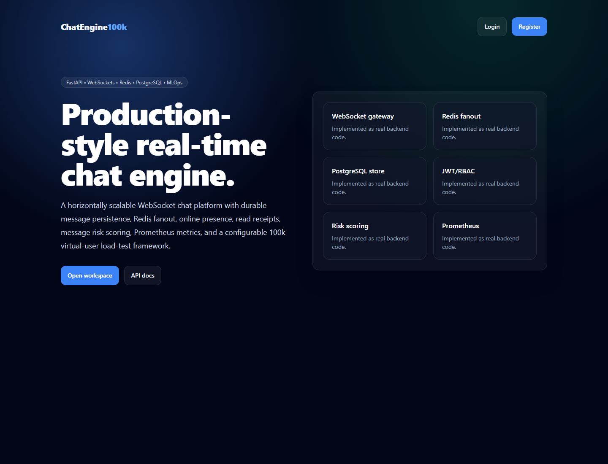
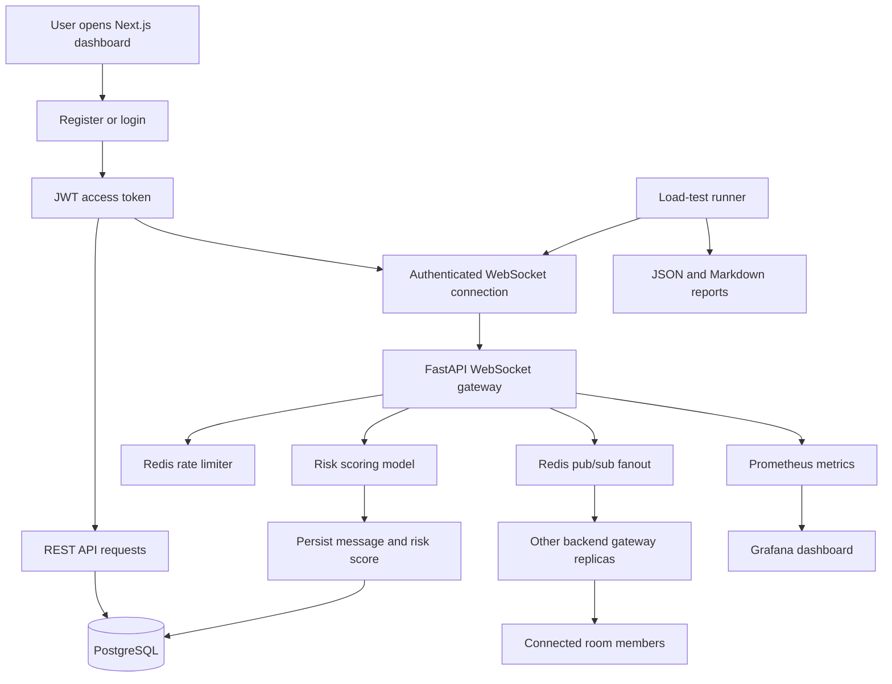
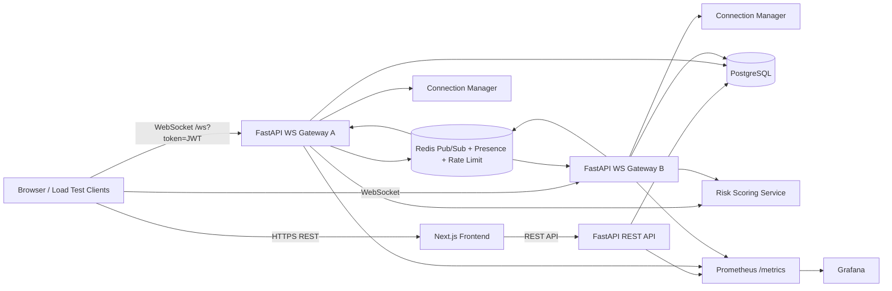
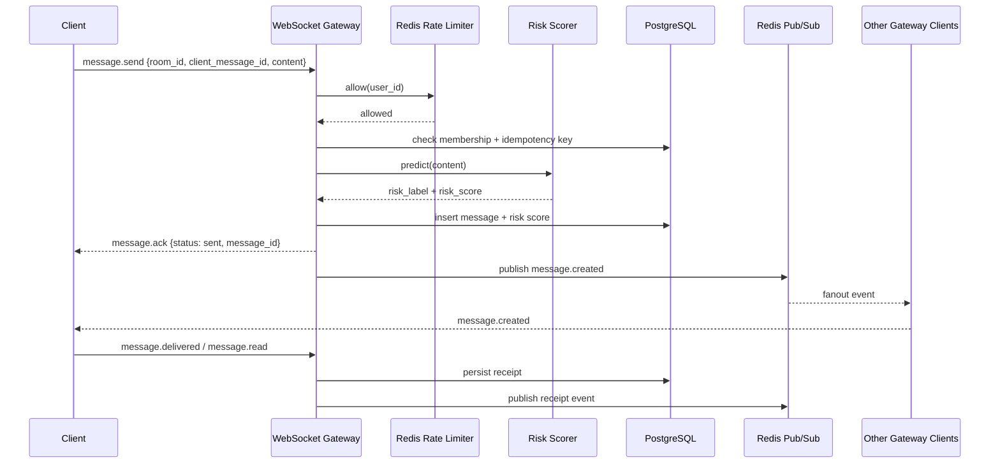
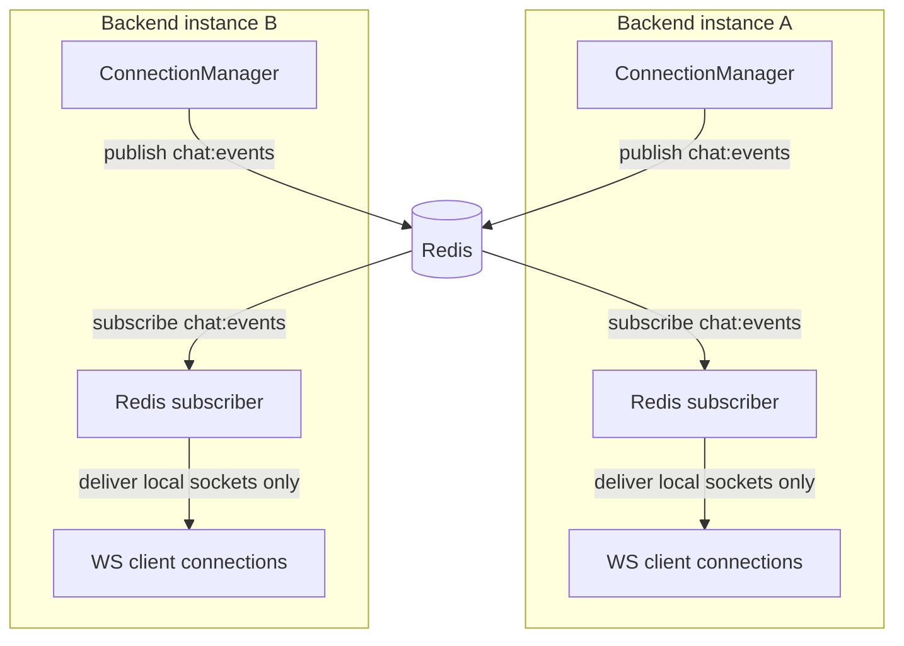
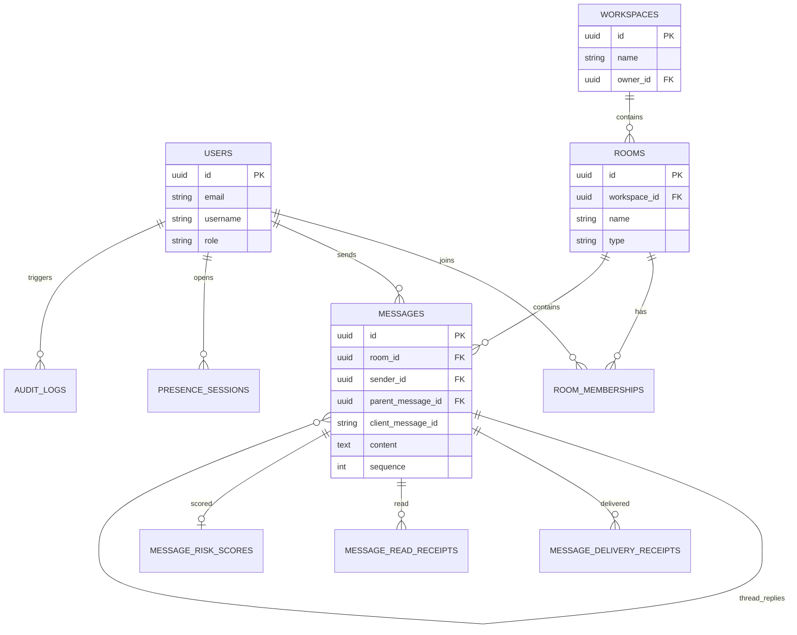

# Realtime Chat Engine

**A horizontally scalable FastAPI + WebSocket chat engine with Redis fanout, PostgreSQL persistence, observability, and a configurable 100k virtual-user load-testing framework.**

<p align="left">
  <a href="#local-setup"></a>
  <a href="#architecture-overview"></a>
  <a href="docs/websocket-protocol.md"></a>
</p>

## About

<p align="left">
  <a href="#local-setup"></a>
</p>

This repository is built as a serious engineering portfolio project for backend, platform, MLOps, and distributed-systems roles. It is not a CRUD demo and it is not a toy Socket.IO clone. The code includes real authentication, real WebSocket message flow, real persistence, real Redis fanout, real risk scoring, real metrics, and a load-test runner that can open real WebSocket connections and validate acknowledgements.

> **Important honesty note:** this repo includes a **100k virtual-user simulation mode**, but a single laptop will usually not sustain 100k real WebSocket clients. The README intentionally separates local profiles from the distributed 100k profile. Use the included 100 / 1k / 10k local profiles first, then run 100k as a distributed multi-machine or multi-container test.

---

## Live screenshot



Captured from the running Next.js app at `http://localhost:3000`.

---

## Why this is not a toy project

| Area | What exists in code |
|---|---|
| Real-time backend | FastAPI WebSocket gateway, connection manager, Redis pub/sub fanout, room join/leave, typing, delivery/read receipts |
| Durable data | PostgreSQL models for users, workspaces, rooms, memberships, messages, threads, receipts, risk scores, audit logs, load test runs |
| Auth/security | Register/login, JWT, password hashing, WebSocket auth, admin-only endpoints, message size validation, rate limiting |
| Scale design | Stateless backend instances, Redis fanout channel, presence heartbeat, idempotent message sending, pagination, backpressure boundaries |
| MLOps | Runnable training script, evaluation script, versioned model artifact, model metadata, model card, FastAPI inference endpoint, risk score saved with messages |
| Observability | Prometheus metrics, structured JSON logs, Grafana provisioning, health endpoints, system metrics in admin APIs |
| Load testing | Real WebSocket client runner, configurable users/rooms/message rate/ramp-up/shards, JSON and Markdown reports |
| Frontend | Next.js + TypeScript + Tailwind dashboard with real API/WebSocket integration, admin/load-test/observability/MLOps pages |

---

## Tech stack

| Layer | Stack |
|---|---|
| Backend API | Python, FastAPI, AsyncIO, SQLAlchemy async, Alembic |
| Realtime | FastAPI WebSockets, Redis pub/sub, in-process connection manager |
| Database | PostgreSQL |
| Cache/events | Redis |
| Auth | JWT, bcrypt password hashing |
| MLOps | Lightweight Naive Bayes risk model, model card, evaluation report script |
| Frontend | Next.js App Router, TypeScript, Tailwind CSS |
| Observability | Prometheus, Grafana, structured JSON logging |
| Load testing | Python asyncio, aiohttp, websockets |
| DevOps | Docker, Docker Compose, Makefile, NGINX config |

---

## Feature matrix

| Feature | Implemented | Notes |
|---|---:|---|
| Register/login | ✅ | `/api/v1/auth/register`, `/api/v1/auth/login` |
| JWT auth | ✅ | Used by REST and WebSocket |
| Workspace model | ✅ | Seed workspace included |
| Room/channel model | ✅ | Create/list/join rooms |
| Direct conversation model | ✅ | Data model and API support |
| Real WebSocket messages | ✅ | `/ws?token=<jwt>` |
| Message persistence | ✅ | PostgreSQL `messages` table |
| Threaded replies | ✅ | `parent_message_id` support |
| Typing indicators | ✅ | WebSocket events via Redis fanout |
| Delivery receipts | ✅ | `message.delivered` event and DB table |
| Read receipts | ✅ | `message.read` event and DB table |
| Online presence | ✅ | Redis TTL keys + DB session rows |
| Rate limiting | ✅ | Redis sliding-window limiter |
| Idempotency | ✅ | Unique `(sender_id, client_message_id)` |
| History pagination | ✅ | Cursor/limit API |
| MLOps scoring | ✅ | Risk endpoint + saved score per message |
| Risk dashboard | ✅ | Admin risky-message API + frontend page |
| Prometheus metrics | ✅ | `/metrics` |
| Grafana dashboard JSON | ✅ | Provisioned dashboard file |
| Load testing | ✅ | `load_tests/ws_load_test.py` |
| Screenshots automation | ✅ | Playwright script saves UI screenshots |

---

## System workflow diagram



---

## Architecture overview



### WebSocket message lifecycle



### Redis fanout design



### Database ERD



### Load testing architecture

```mermaid
flowchart LR
    LT[ws_load_test.py] -->|provision users/rooms| API[FastAPI Load Test API]
    API --> DB[(PostgreSQL)]
    LT -->|JWT WebSocket connections| WS1[Backend A]
    LT -->|JWT WebSocket connections| WS2[Backend B]
    WS1 <--> R[(Redis Pub/Sub)]
    WS2 <--> R
    WS1 --> DB
    WS2 --> DB
    LT --> REP[JSON + Markdown report]
    WS1 --> MET[/metrics]
    WS2 --> MET
    MET --> PROM[Prometheus]
```

### MLOps workflow

```mermaid
flowchart LR
    D[mlops/data/chat_risk_samples.csv] --> T[training/train_risk_model.py]
    T --> M[models/current/risk_model.json]
    M --> E[evaluation/evaluate_risk_model.py]
    E --> R[reports/evaluation_report.json]
    M --> API[/api/v1/mlops/score]
    API --> MSG[Message risk score saved in DB]
    MSG --> ADM[Admin risky messages dashboard]
    API --> PM[Prometheus ML latency and count metrics]
```

---

## Repository structure

```text
realtime-chat-engine/
  backend/
    app/
      api/                 # REST routes
      core/                # settings and logging
      db/                  # async database session and seed data
      models/              # SQLAlchemy models
      schemas/             # Pydantic request/response schemas
      services/            # message, Redis, rate limiter services
      realtime/            # WebSocket protocol, manager, handlers
      ml/                  # inference wrapper for model artifact
      observability/       # Prometheus and system metrics
      security/            # JWT, passwords, dependencies
      tests/               # backend tests
    alembic/               # migrations
    Dockerfile
    requirements.txt
  frontend/
    app/                   # Next.js pages
    components/            # UI components
    hooks/                 # WebSocket hook
    lib/                   # API client
    tests/                 # Vitest + Playwright screenshots
    Dockerfile
  mlops/
    data/
    training/
    evaluation/
    models/current/
    reports/
    model_card.md
  load_tests/
    ws_load_test.py
    scenarios/
    reports/
  observability/
    prometheus/
    grafana/
  infra/nginx/
  docs/
  scripts/
  docker-compose.yml
  docker-compose.dev.yml
  Makefile
  README.md
  .env.example
```

---

## Local setup

### 1. Copy env file

```bash
cp .env.example .env
```

For a public repo, keep `.env` out of Git and rotate `JWT_SECRET` before any public deployment.

### 2. Start the full stack

```bash
docker compose up --build
```

Default URLs:

| Service | URL |
|---|---|
| Frontend | http://localhost:3000 |
| Backend API | http://localhost:8000 |
| FastAPI docs | http://localhost:8000/docs |
| Health | http://localhost:8000/health |
| Prometheus metrics | http://localhost:8000/metrics |
| Prometheus UI | http://localhost:9090 |
| Grafana | http://localhost:3001 |

Grafana default login is configured in Docker Compose as `admin / admin` for local development only.

### 3. Demo users

The backend seed script creates demo data on startup.

| Role | Email | Password |
|---|---|---|
| Admin | admin@example.com | Admin123! |
| User | demo@example.com | Demo123! |

---

## Make commands

```bash
make up                 # docker compose up --build
make down               # stop containers
make logs               # follow logs
make test               # backend tests + frontend tests inside containers
make train-model        # train lightweight risk model
make load-test-small    # 100 virtual users
make load-test-1k       # 1,000 virtual users
make load-test-10k      # 10,000 virtual users, still machine dependent
make screenshots        # generate Playwright screenshots
```

---

## API overview

| Area | Endpoint |
|---|---|
| Health | `GET /health`, `GET /api/v1/health` |
| Auth | `POST /api/v1/auth/register`, `POST /api/v1/auth/login` |
| Users | `GET /api/v1/users/me` |
| Workspaces | `GET /api/v1/workspaces`, `POST /api/v1/workspaces` |
| Rooms | `GET /api/v1/rooms`, `POST /api/v1/rooms`, `POST /api/v1/rooms/{room_id}/join` |
| Messages | `GET /api/v1/messages/rooms/{room_id}?limit=50&before=<message_id>` |
| Admin | `GET /api/v1/admin/stats`, `GET /api/v1/admin/risky-messages` |
| MLOps | `POST /api/v1/mlops/score`, `GET /api/v1/mlops/model-info` |
| Load tests | `POST /api/v1/load-tests/runs`, `GET /api/v1/load-tests/runs`, `POST /api/v1/load-tests/provision` |
| Metrics | `GET /metrics` |
| WebSocket | `GET /ws?token=<jwt>` |

Detailed WebSocket protocol: [`docs/websocket-protocol.md`](docs/websocket-protocol.md)

---

## WebSocket protocol summary

Client events include:

```json
{"type":"room.join","request_id":"req-1","payload":{"room_id":"..."}}
{"type":"message.send","request_id":"req-2","payload":{"room_id":"...","client_message_id":"uuid-from-client","content":"hello"}}
{"type":"typing.start","payload":{"room_id":"..."}}
{"type":"typing.stop","payload":{"room_id":"..."}}
{"type":"message.delivered","payload":{"room_id":"...","message_id":"..."}}
{"type":"message.read","payload":{"room_id":"...","message_id":"..."}}
```

Server events include:

```json
{"type":"connection.init","payload":{"connection_id":"...","user":{"id":"...","username":"demo"}}}
{"type":"message.ack","request_id":"req-2","payload":{"client_message_id":"...","message_id":"...","status":"sent"}}
{"type":"message.created","payload":{"id":"...","room_id":"...","content":"hello","risk_label":"safe"}}
{"type":"error.rate_limited","payload":{"remaining":0}}
```

---

## MLOps component

The MLOps part is intentionally lightweight but real:

1. `mlops/data/chat_risk_samples.csv` contains labeled sample messages.
2. `mlops/training/train_risk_model.py` trains a small Naive Bayes text classifier.
3. `mlops/models/current/risk_model.json` is a versioned model artifact.
4. `mlops/evaluation/evaluate_risk_model.py` writes an evaluation report.
5. FastAPI loads the model and exposes `/api/v1/mlops/score`.
6. Every persisted chat message stores `risk_label`, `risk_score`, and matched/risk terms in `message_risk_scores`.
7. Admin dashboard can inspect risky messages.
8. Prometheus tracks prediction count and inference latency.

Run it:

```bash
make train-model
python mlops/evaluation/evaluate_risk_model.py
```

---

## Load testing

The load tester opens real WebSocket connections, joins rooms, sends real messages, waits for acknowledgements, records received messages, and writes JSON/Markdown reports.

### Small local test

```bash
make load-test-small
```

Equivalent:

```bash
python load_tests/ws_load_test.py --users 100 --rooms 10 --message-rate 1 --ramp-up 30 --duration 60
```

### 1,000 users

```bash
make load-test-1k
```

### 10,000 users

```bash
make load-test-10k
```

This profile is machine dependent. Increase OS file descriptor limits and run on a strong machine.

### 100,000 distributed simulation profile

```bash
python load_tests/ws_load_test.py \
  --users 100000 \
  --rooms 1000 \
  --message-rate 1 \
  --ramp-up 600 \
  --duration 900 \
  --shards 10 \
  --shard-index 0
```

Run shard indexes `0..9` on separate machines/containers. Each shard handles about 10,000 users. The script refuses very large single-process runs by default because that would create misleading benchmark claims. Use `--force-single-process` only when you understand the OS/network limits.

### Metrics collected by the load test

| Metric | Meaning |
|---|---|
| connected_users | WebSocket connections successfully established |
| failed_connections | Connections that failed during setup |
| messages_sent | Messages written by virtual users |
| messages_received | `message.created` events received |
| acked_messages | `message.ack` events received |
| dropped_messages | sent minus acked |
| p50/p95/p99 latency | client-observed ack latency |
| client_cpu_percent | local process/system CPU sampling |
| client_memory_mb | local RSS memory estimate |

Reports are written to `load_tests/reports/*.json` and `*.md`.

---

## What is real vs simulated

| Item | Real | Simulated |
|---|---:|---:|
| User registration/login | ✅ |  |
| JWT WebSocket auth | ✅ |  |
| Room creation/joining | ✅ |  |
| WebSocket connections | ✅ |  |
| PostgreSQL message persistence | ✅ |  |
| Redis pub/sub fanout | ✅ |  |
| Presence heartbeat | ✅ |  |
| Delivery/read receipts | ✅ |  |
| MLOps inference | ✅ |  |
| Grafana/Prometheus metrics | ✅ |  |
| 100k user execution on one laptop |  | ✅ not claimed |
| 100k distributed profile | ✅ framework | Requires enough hosts/resources |
| Benchmark numbers in README |  | Intentionally not included |

---

## Known limitations

1. Redis pub/sub is enough for realtime fanout, but it does not persist events. For stronger guarantees, replace or extend it with Redis Streams, Kafka, NATS JetStream, or a durable outbox dispatcher.
2. The current WebSocket gateway keeps connection state in memory. Horizontal scaling works through Redis fanout, but each connection still belongs to one backend instance.
3. The 100k test requires OS tuning, multiple machines/containers, and realistic network capacity.
4. The ML risk model is intentionally lightweight for a portfolio repo. It demonstrates an end-to-end MLOps loop but is not a production moderation model.
5. Docker Compose is local-development infrastructure. Production would use Kubernetes, ECS, Nomad, or another orchestrator.

---

## Scaling strategy for 100k users

| Layer | Local version | 100k strategy |
|---|---|---|
| Backend | 1 FastAPI container | Multiple stateless FastAPI gateway replicas behind NGINX/LB |
| WebSocket state | In-memory per instance | Sticky sessions optional; Redis/Kafka fanout for cross-instance delivery |
| Fanout | Redis pub/sub | Redis Cluster, NATS, Kafka, or sharded room event buses |
| DB | Single PostgreSQL | Connection pooling, read replicas, partition messages by workspace/time, tune indexes |
| Presence | Redis TTL keys | Redis Cluster, per-region presence shards |
| Load test | Single process for small profiles | Sharded load generators across machines |
| Observability | Prometheus scrape | Prometheus federation/remote write, central logs/traces |

Recommended production path:

1. Put NGINX or cloud LB in front of backend replicas.
2. Run 4-16 FastAPI WebSocket gateway replicas.
3. Add PgBouncer before PostgreSQL.
4. Partition messages by workspace and time for large retention.
5. Replace Redis pub/sub with Redis Streams/NATS/Kafka if message fanout durability becomes mandatory.
6. Separate WebSocket gateway, REST API, and worker deployments.
7. Use autoscaling based on active WebSocket count, CPU, and event loop lag.
8. Run distributed load shards and compare Prometheus metrics with generated load-test reports.

---

## Observability

Prometheus metrics include:

- `chat_ws_active_connections`
- `chat_ws_active_users`
- `chat_active_rooms`
- `chat_messages_sent_total`
- `chat_messages_received_total`
- `chat_message_latency_seconds`
- `chat_db_write_latency_seconds`
- `chat_redis_publish_latency_seconds`
- `chat_ml_inference_latency_seconds`
- `chat_ml_predictions_total`
- `chat_rate_limit_events_total`
- `chat_ws_errors_total`

Grafana dashboard JSON is located at:

```text
observability/grafana/dashboards/chat-engine-dashboard.json
```

---

## Screenshots

The repo includes a Playwright screenshot script rather than fake static screenshots.

```bash
make screenshots
```

It saves screenshots into:

```text
docs/screenshots/
```

Target pages:

- Landing page
- Login page
- Register page
- Main chat page
- Admin dashboard
- Load test dashboard
- Observability dashboard
- MLOps dashboard

---

## Testing

```bash
make test
```

Backend tests cover:

- Auth flow
- MLOps inference
- Redis rate limiter logic
- Health routes and basic API behavior

The repo is structured so additional CI jobs can add PostgreSQL/Redis integration and WebSocket multi-instance tests.

---

## Deployment notes

Local:

```bash
docker compose up --build
```

Multiple backend replicas locally:

```bash
docker compose up --build --scale backend=3
```

For true multi-instance WebSocket testing, put NGINX or a load balancer in front of replicated backend containers. The included NGINX config is in `infra/nginx/nginx.conf`.

---

## Resume bullets

- Built a horizontally scalable real-time chat engine using FastAPI WebSockets, Redis pub/sub fanout, PostgreSQL persistence, JWT authentication, and Docker Compose deployment.
- Implemented production-style message delivery semantics including idempotent sends, delivery acknowledgements, read receipts, typing indicators, room membership checks, history pagination, and online presence heartbeats.
- Designed and implemented a configurable WebSocket load-testing framework with 100 / 1k / 10k local profiles and a sharded 100k virtual-user distributed simulation mode with JSON/Markdown reporting.
- Integrated an end-to-end MLOps moderation pipeline with training, evaluation, model metadata, FastAPI inference, persisted risk scores, admin review dashboard, and Prometheus model-latency metrics.
- Added observability with Prometheus metrics, Grafana dashboard provisioning, structured JSON logs, health checks, and admin system statistics.

---

## GitHub repository description

> A production-style FastAPI + Next.js real-time chat platform with WebSocket gateway, Redis fanout, PostgreSQL persistence, MLOps risk scoring, Prometheus/Grafana observability, and a configurable 100k virtual-user load-testing framework.

Suggested GitHub topics:

```text
fastapi websocket redis postgresql nextjs realtime-chat distributed-systems mlops prometheus grafana load-testing docker portfolio-project
```
