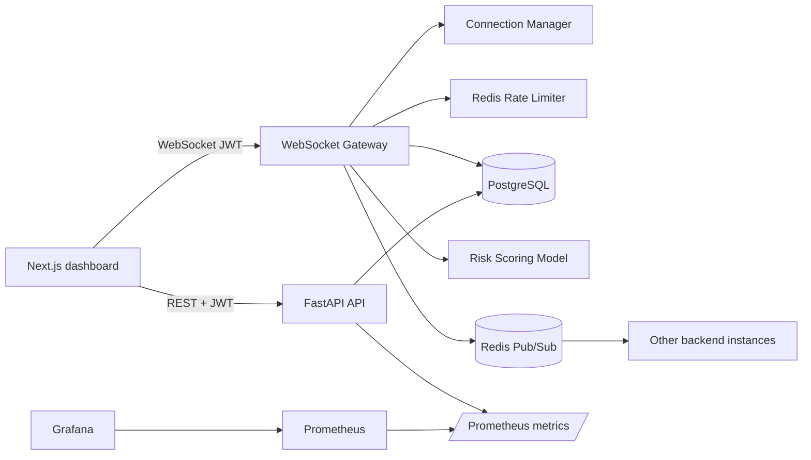
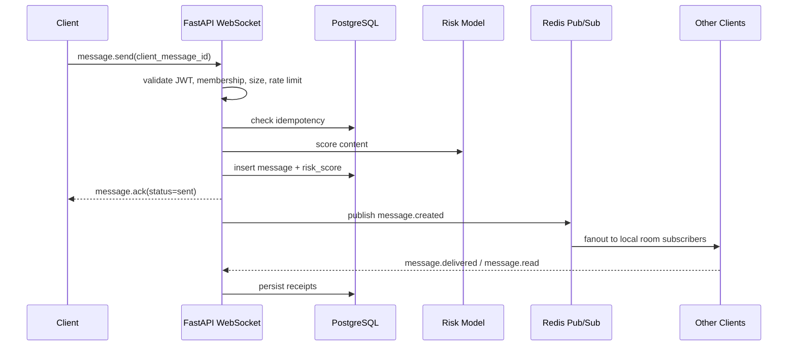
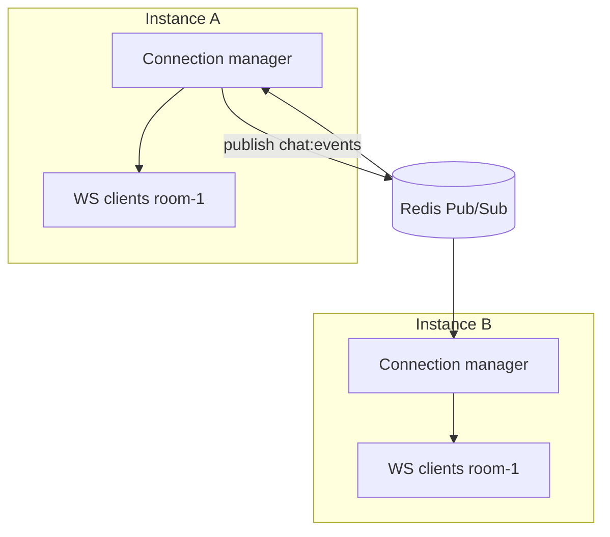
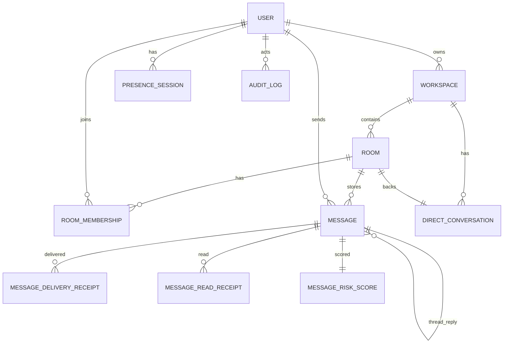

# Architecture

The backend can run as multiple instances behind NGINX/LB because room fanout is not stored only in process memory. Each instance keeps its own local WebSocket connections, and Redis pub/sub carries events across instances.

## Message lifecycle

## Redis fanout

## Database ERD

