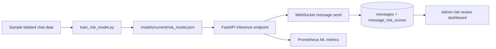

# MLOps Workflow



## Train

```bash
python mlops/training/train_risk_model.py --data mlops/data/chat_risk_samples.csv --out mlops/models/current/risk_model.json
```

## Evaluate

```bash
python mlops/evaluation/evaluate_risk_model.py
```

## Inference endpoint

```text
POST /api/v1/mlops/risk-score
```

Every persisted chat message stores `risk_score`, `risk_label`, and a row in `message_risk_scores` with model version and inference latency.
